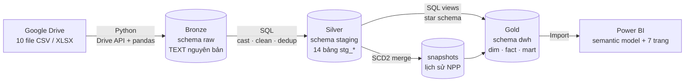
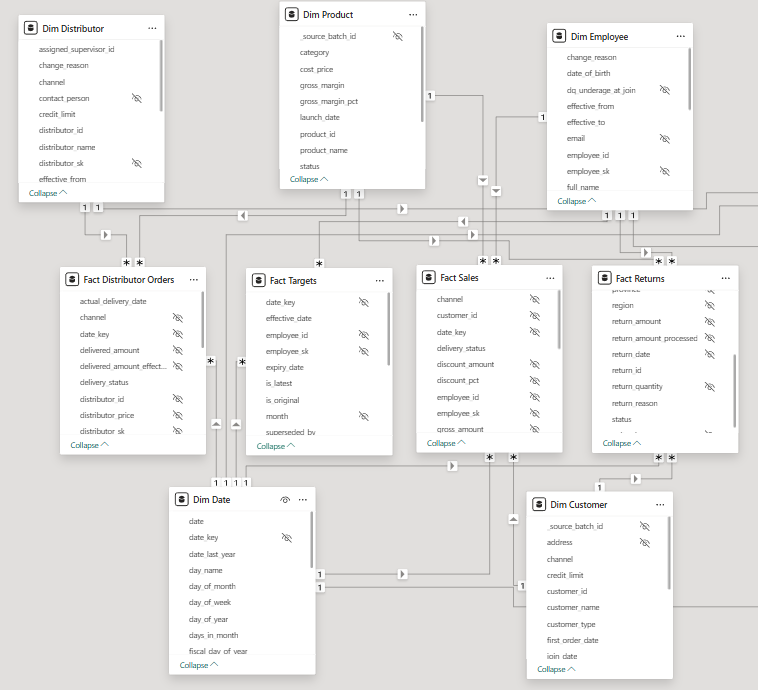
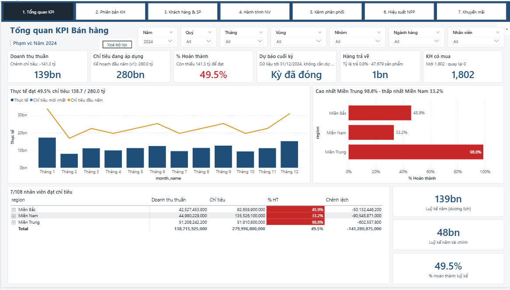
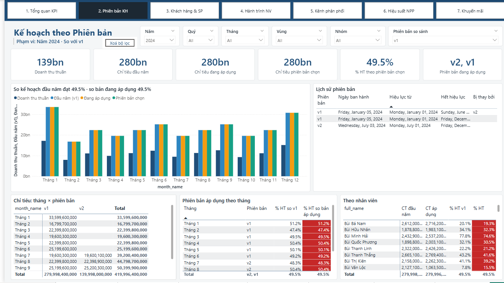
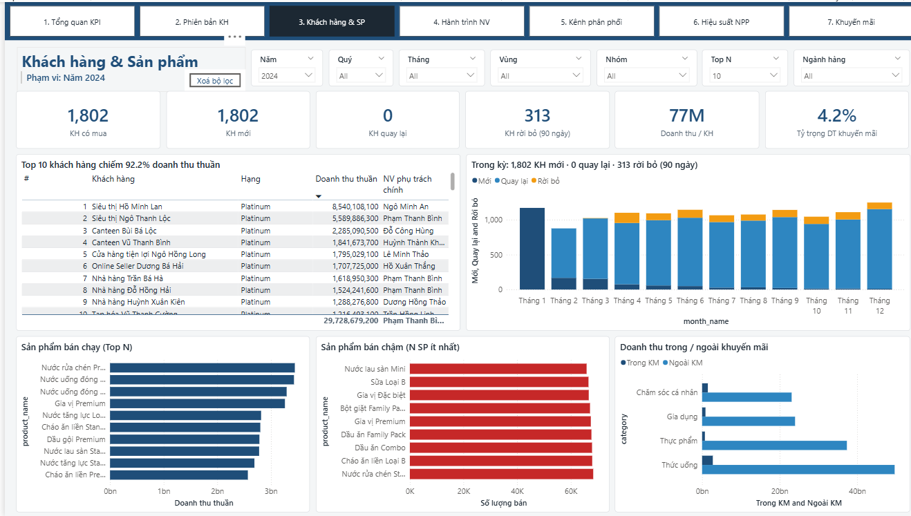
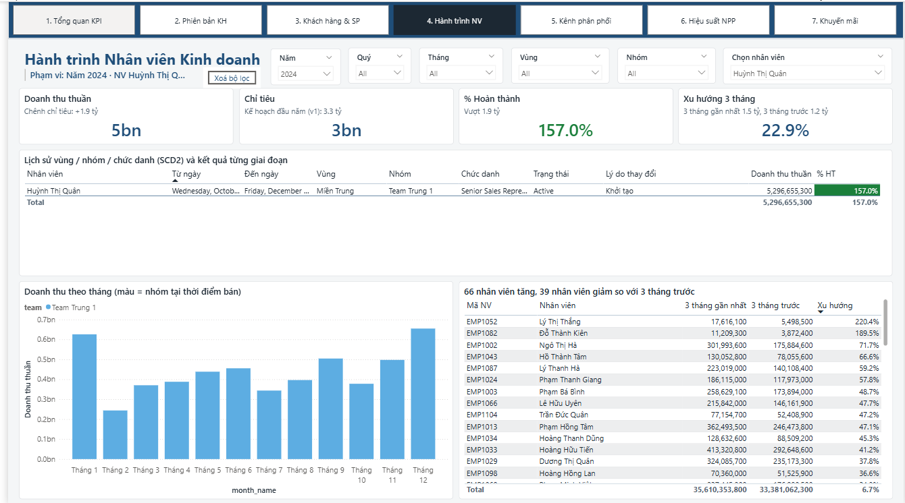
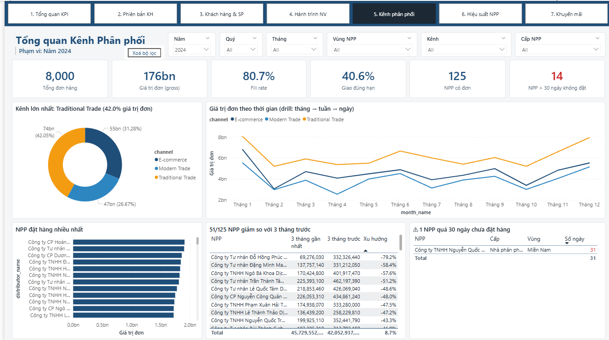
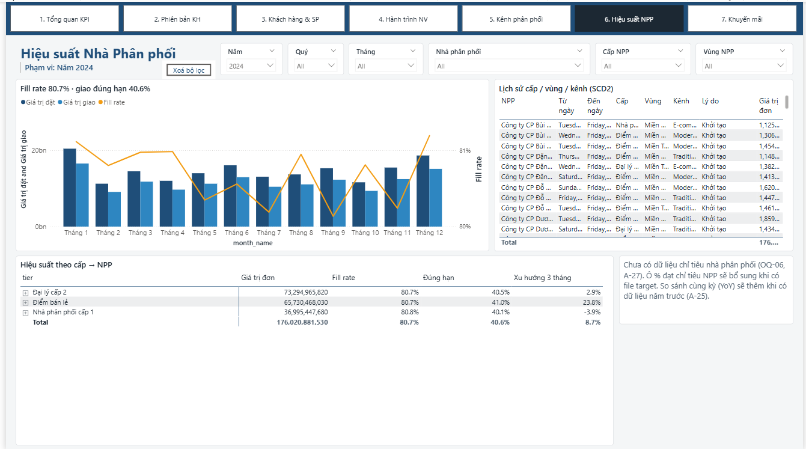
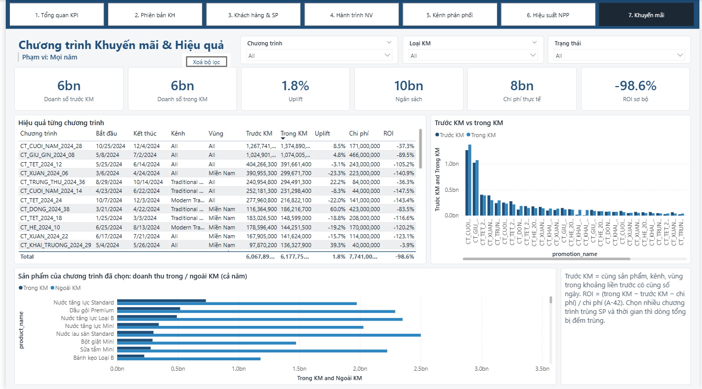

# VietDist Analytics: Sales Performance & Distribution Analytics Platform

Pipeline dữ liệu end-to-end cho một công ty phân phối hàng tiêu dùng nhanh (FMCG). Dữ liệu nguồn là 10 file Excel/CSV rời rạc trên Google Drive. Pipeline nạp chúng vào **PostgreSQL** theo kiến trúc **Medallion** (Bronze → Silver → Gold), rồi phục vụ **dashboard Power BI** 7 trang cho phòng Kinh doanh trực tiếp và phòng Phân phối & Kênh.

> Dự án thực tập Analytics Engineer. Toàn bộ pipeline chạy trên máy cá nhân (localhost).

---

## Mục lục

- [Bài toán](#bài-toán)
- [Kiến trúc](#kiến-trúc)
- [Công nghệ](#công-nghệ)
- [Điểm nổi bật](#điểm-nổi-bật)
- [Cấu trúc thư mục](#cấu-trúc-thư-mục)
- [Cài đặt và chạy](#cài-đặt-và-chạy)
- [Kiểm thử và đối soát](#kiểm-thử-và-đối-soát)
- [Dashboard Power BI](#dashboard-power-bi)
- [Tài liệu](#tài-liệu)
- [Giới hạn hiện tại](#giới-hạn-hiện-tại)

---

## Bài toán

VietDist là một công ty phân phối FMCG trên 3 miền. Dữ liệu kinh doanh nằm rải rác ở nhiều file do từng phòng ban tự cập nhật: giao dịch bán hàng, chỉ tiêu, khách hàng, sản phẩm, nhà phân phối, nhân viên, khuyến mãi… Ban lãnh đạo cần **một hệ thống báo cáo thống nhất, tự động** để:

- theo dõi **doanh thu thực tế so với chỉ tiêu** theo nhân viên, nhóm, vùng; so sánh được với **từng phiên bản kế hoạch** (kế hoạch đầu năm, các bản điều chỉnh);
- xem **lịch sử của nhân viên và nhà phân phối** (chuyển vùng, đổi cấp) mà báo cáo của giai đoạn cũ không bị thay đổi;
- đo **hiệu suất kênh phân phối**: fill rate, giao đúng hạn, cảnh báo nhà phân phối hơn 30 ngày không đặt hàng;
- đánh giá **khách hàng, sản phẩm và chương trình khuyến mãi**: Top N, khách mới hoặc rời bỏ, doanh thu trong và ngoài kỳ khuyến mãi, ROI.

**Hai bài toán khó nhất:**
1. **Chỉ tiêu nhiều phiên bản trong năm.** v1 đầu năm, v2 điều chỉnh từ tháng 7, có thể có v3, v4… Hệ thống phải giữ mọi phiên bản và biết phiên bản nào có hiệu lực ở từng tháng.
2. **Thay đổi tổ chức theo thời gian (SCD Type 2).** Doanh số phải gắn với vùng/nhóm của nhân viên **tại thời điểm bán**, không phải vùng hiện tại.

---

## Kiến trúc



| Tầng | Schema | Nội dung | Công cụ |
|---|---|---|---|
| **Bronze** | `raw` | Dữ liệu y nguyên file gốc: mọi cột là TEXT, kèm metadata `_source_file`, `_source_sheet`, `_ingested_at`, `_batch_id`. Chỉ append | Python |
| **Silver** | `staging` | Ép đúng kiểu, chuẩn hoá, dedup, có PRIMARY KEY; tách bảng cầu; tính phiên bản chỉ tiêu | SQL |
| **Gold** | `dwh` | Star schema dạng **view**: 6 dimension, 4 fact, 2 mart, 1 bảng cầu khuyến mãi | SQL |
| — | `snapshots` | Lịch sử SCD2 mà nguồn không lưu (nhà phân phối), cập nhật tăng dần | SQL |
| **Serving** | — | Semantic model (103 measure, 5 vai trò RLS) và 7 trang báo cáo | Power BI (PBIP) |

---

## Công nghệ

| Nhóm | Công cụ |
|---|---|
| Ngôn ngữ | Python 3.13, SQL (PostgreSQL), DAX, Power Query M |
| Thư viện Python | `pandas`, `openpyxl`, `pyxlsb`, `SQLAlchemy`, `psycopg2`, `google-api-python-client`, `google-auth`, `python-dotenv` |
| Database | PostgreSQL 18 |
| BI | Power BI Desktop, định dạng **PBIP** (semantic model dạng TMDL, report dạng PBIR) |
| Nguồn dữ liệu | Google Drive (service account, quyền chỉ đọc) |

---

## Điểm nổi bật

**Ingestion (Bronze)**
- **Một loader dùng chung** (`base_loader.py`). Mỗi nguồn chỉ khai báo vài dòng cấu hình; thêm nguồn mới khoảng 10 dòng.
- **Mỗi file nạp trong một transaction**, gồm cả dữ liệu lẫn dòng log. Lỗi thì rollback rồi ghi log FAILED và chạy tiếp file khác; mọi lần chạy được ghi vào `raw.ingest_log`.
- Nạp bằng lệnh **`COPY`** của PostgreSQL: 119 nghìn dòng chỉ mất vài giây.
- **Tự xử lý khi file đổi cấu trúc:** file có thêm cột thì bảng tự thêm cột; file có nhiều sheet thì mỗi sheet đổ vào bảng tương ứng theo mẫu tên (`Employee_v*`).
- **Đọc được nhiều dạng file:** CSV, XLSX, XLSM, XLSB; tự nhận bảng mã (UTF-8 / CP1258) và ký tự ngăn cách; giữ nguyên số 0 đầu của SĐT và mã số thuế.
- **Loader chỉ tiêu** tự nhận phiên bản từ tên sheet, tên file hoặc cột; đọc được cả dạng long lẫn dạng wide (T1..T12, dòng TỔNG); **báo lỗi thay vì tự đoán** khi phiên bản mâu thuẫn.

**Transformation (Silver và Gold)**
- **Ép kiểu fail-fast:** gặp giá trị sai kiểu thì dừng và báo đúng bảng, cột, giá trị. Model lỗi được rollback, bảng cũ giữ nguyên.
- **Chỉ tiêu dạng temporal fact:** mỗi dòng có `effective_date`, `expiry_date`, `is_latest`, `is_original`; không giới hạn số phiên bản; truy vấn được "kế hoạch đang hiệu lực tại ngày X".
- **SCD Type 2:** `dim_employees` dựng lại từ các snapshot của nguồn; `dim_distributors` cập nhật tăng dần (merge), chạy lại không sinh thêm dòng. Fact join theo `ngày BETWEEN effective_from AND effective_to`.
- **Năm tài chính** (01/09 → 31/08) song song với năm dương lịch; quy tắc so sánh cùng kỳ khi gặp ngày 29/02.

**Chất lượng dữ liệu**
- Profiling tự động mọi cột, kèm báo cáo vấn đề dữ liệu theo mẫu *Incorrect types / Incorrect values / Missing / Duplicates → Next step*.
- **352 test kiểu dbt** (unique, not_null, accepted_values, relationships, expression…), chạy bằng một lệnh, mục tiêu 0 lỗi.
- **Đối soát end-to-end:** số dòng và tổng tiền khớp từ file gốc → raw → staging → dwh → Power BI.
- **Mô phỏng các tình huống chưa có trong dữ liệu** (phiên bản v3, nhà phân phối đổi cấp, file dạng wide) trong transaction rồi rollback, để chứng minh logic mà không làm bẩn DB.

**Power BI**
- **Report sinh bằng code Python** (định dạng PBIR): 7 trang 1920 × 1080, 137 visual, layout thống nhất trên mọi trang.
- 103 measure DAX được đối soát với SQL; 5 vai trò **Row-Level Security** theo cấp bậc tổ chức; drillthrough sang trang nhân viên và trang nhà phân phối.

---

## Cấu trúc thư mục

```
VietDist/
├── 00_setup/
│   ├── requirements.txt           # thư viện Python
│   ├── .env.example               # mẫu biến môi trường (DB, Google Drive)
│   ├── init_db.sql                # tạo DB vietdist_dw + các schema
│   └── check_env.py               # kiểm tra môi trường (Phase 0)
├── 01_ingestion/                  # Bronze
│   ├── connectors/
│   │   └── gdrive_connector.py    #   liệt kê + tải file từ Google Drive
│   ├── utils/
│   │   ├── file_parser.py         #   đọc CSV / XLSX / XLSM / XLSB
│   │   └── db_utils.py            #   nạp bằng COPY, ghi ingest_log
│   ├── loaders/
│   │   ├── base_loader.py         #   logic dùng chung cho mọi loader
│   │   ├── load_sales_targets.py  #   chỉ tiêu nhiều phiên bản
│   │   └── load_*.py              #   9 loader còn lại (mỗi nguồn 1 file)
│   ├── sql/                       #   DDL bảng hệ thống (ingest_log, sales_target_files)
│   ├── tests/                     #   check_task_1_1 / 1_3 / 1_4.py
│   └── run_bronze.py              #   chạy cả 10 nguồn
├── 02_sql_analytics/              # Silver + Gold
│   ├── profiling/                 #   profile_raw.py, profiling_checks.sql
│   ├── staging/                   #   00_helpers.sql + 13 model stg_*.sql
│   ├── snapshots/                 #   01_distributors.sql: SCD2 merge cho nhà phân phối
│   ├── dwh/                       #   00_helpers.sql + 13 view dim_* / fact_* / mart_* / bridge_*
│   ├── tests/                     #   dq.py, test_staging.py, test_dwh.py, test_target_versioning.py
│   ├── model_runner.py
│   ├── run_staging.py             #   build Silver rồi tự tạo lại Gold
│   └── run_dwh.py
├── 03_power_bi/
│   ├── Vietdist dashboard.pbip    # file project Power BI
│   └── Vietdist dashboard.pdf     # bản xuất PDF của dashboard
├── docs/
│   ├── data_profile.md            # profiling tự động từng cột
│   ├── data_issues.md             # vấn đề dữ liệu và cách xử lý
│   └── assumptions_log.md         # các giả định thiết kế
├── images/                        # ảnh chụp dashboard và data model
└── README.md
```

> Semantic model, các trang report và script sinh report của Power BI chỉ được giữ trên máy, không đưa lên repo. Xem dashboard qua [bản PDF](03_power_bi/Vietdist%20dashboard.pdf) hoặc [ảnh chụp](#ảnh-chụp-các-trang-dữ-liệu-mẫu-năm-2024).

---

## Cài đặt và chạy

### Yêu cầu
- Python 3.11 trở lên, PostgreSQL 16 trở lên (dự án chạy trên bản 18), Power BI Desktop (bản hỗ trợ PBIP).
- Một **Google service account** được share quyền Viewer vào folder Drive chứa dữ liệu nguồn.

> Dữ liệu nguồn và key của service account **không nằm trong repo**.

### 1. Môi trường
```bash
python -m venv venv
venv\Scripts\activate                  # Windows  (Mac/Linux: source venv/bin/activate)
pip install -r 00_setup/requirements.txt

copy 00_setup\.env.example .env        # rồi điền DB_PASSWORD, GDRIVE_FOLDER_ID
# đặt key service account tại credentials/gdrive_service_account.json

psql -U postgres -h localhost -f 00_setup/init_db.sql   # tạo DB vietdist_dw + các schema
python 00_setup/check_env.py                             # kiểm tra môi trường
```

### 2. Chạy pipeline
```bash
python 01_ingestion/run_bronze.py        # Bronze: nạp 10 nguồn từ Drive vào raw
python 02_sql_analytics/run_staging.py   # Silver, rồi tự tạo lại snapshots và view Gold
```

> Bronze **chỉ append**: chạy lại loader sẽ nhân đôi dữ liệu trong `raw` (đúng thiết kế, Silver sẽ dedup). Silver và Gold thì chạy lại bao nhiêu lần cũng an toàn.

### 3. Kiểm thử
```bash
python 02_sql_analytics/tests/test_staging.py
python 02_sql_analytics/tests/test_target_versioning.py
python 02_sql_analytics/tests/test_dwh.py
```

### 4. Power BI
Semantic model và các trang report không có trong repo. Có thể xem dashboard qua [bản PDF](03_power_bi/Vietdist%20dashboard.pdf) hoặc [ảnh chụp các trang](#ảnh-chụp-các-trang-dữ-liệu-mẫu-năm-2024).
Model đọc trực tiếp các view trong schema `dwh` ở chế độ Import, nên chỉ cần chạy xong bước 2 là có đủ dữ liệu cho dashboard.

---

## Kiểm thử và đối soát

| Bộ kiểm tra | Phạm vi | Kết quả |
|---|---|---|
| `check_task_1_1/1_3/1_4.py` | checkpoint ingestion: kết nối, số dòng so với file, chạy 2 lần, phiên bản chỉ tiêu | đạt toàn bộ |
| `test_staging.py` | 14 bảng Silver | **202 / 202** |
| `test_target_versioning.py` | logic phiên bản chỉ tiêu, mô phỏng v3 | **15 / 15** |
| `test_dwh.py` | 13 view Gold, mô phỏng SCD2 | **135 / 135** |
| Đối soát file gốc → dwh | 33 chỉ số tổng, 25 dòng mẫu ngẫu nhiên | khớp 100% |
| Đối soát Power BI → SQL | Net Revenue, Target, Active Customers, Fill Rate… theo tháng | khớp 12/12 tháng |

Một vài con số đối soát (năm 2024): 119.101 dòng bán hàng; Net Revenue **138.715.925.000đ**; tổng chỉ tiêu đang áp dụng **279.996.800.000đ**, khớp với sheet `Summary` do business lập trong file gốc.

---

## Dashboard Power BI

| Trang | Nội dung | Yêu cầu nghiệp vụ |
|---|---|---|
| 1. Tổng quan KPI | Doanh thu thuần, chỉ tiêu, % hoàn thành (xanh/đỏ), dự báo cuối kỳ, hàng trả, luỹ kế năm dương lịch và năm tài chính | BR-A-01 |
| 2. Phiên bản kế hoạch | Thực tế so với v1, với bản đang áp dụng, với phiên bản chọn; tháng nào áp dụng phiên bản nào | BR-A-02 |
| 3. Khách hàng & Sản phẩm | Top N khách hàng; khách mới / quay lại / rời bỏ; sản phẩm bán chạy / chậm; doanh thu trong / ngoài khuyến mãi | BR-A-03 |
| 4. Hành trình nhân viên | Lịch sử vùng / nhóm / chức danh và kết quả từng giai đoạn; xu hướng 3 tháng (trang drillthrough) | BR-A-04 |
| 5. Kênh phân phối | Đơn hàng, fill rate, giao đúng hạn, channel mix, nhà phân phối hơn 30 ngày không đặt | BR-B-01 |
| 6. Hiệu suất nhà phân phối | Xu hướng, lịch sử cấp / vùng / kênh (trang drillthrough) | BR-B-02 |
| 7. Khuyến mãi | Doanh số trước / trong kỳ khuyến mãi, uplift, chi phí, ROI | BR-B-04 |

**Row-Level Security:** Ban Giám đốc, Giám đốc vùng, Trưởng nhóm, Nhân viên Sales, Quản lý NPP. Phân quyền xác định qua email đăng nhập (`USERPRINCIPALNAME()`).

### Data model

Star schema: các fact (`Fact Sales`, `Fact Returns`, `Fact Targets`, `Fact Distributor Orders`) nối nhiều-một tới các dimension. `Dim Employee` và `Dim Distributor` là SCD2, nối qua khoá thay thế (`employee_sk`, `distributor_sk`) theo ngày giao dịch.



### Ảnh chụp các trang (dữ liệu mẫu năm 2024)

**1. Tổng quan KPI**: doanh thu thuần, chỉ tiêu đang áp dụng, % hoàn thành theo vùng và nhân viên, luỹ kế năm dương lịch / năm tài chính.



**2. Kế hoạch theo phiên bản**: so thực tế với kế hoạch đầu năm (v1), bản đang áp dụng và phiên bản chọn; lịch sử phiên bản; tháng nào áp dụng phiên bản nào.



**3. Khách hàng & Sản phẩm**: Top N khách hàng, vòng đời khách hàng (mới / quay lại / rời bỏ), sản phẩm bán chạy và bán chậm, doanh thu trong / ngoài khuyến mãi.



**4. Hành trình nhân viên**: lịch sử vùng / nhóm / chức danh (SCD2) và kết quả từng giai đoạn, xếp hạng xu hướng 3 tháng.



**5. Kênh phân phối**: tổng đơn, fill rate, giao đúng hạn, channel mix, nhà phân phối giảm sút và nhà phân phối hơn 30 ngày không đặt hàng.



**6. Hiệu suất nhà phân phối**: giá trị đặt / giao và fill rate theo tháng, lịch sử cấp / vùng / kênh (SCD2), hiệu suất theo cấp.



**7. Khuyến mãi**: doanh số trước / trong kỳ khuyến mãi, uplift, ngân sách, chi phí và ROI từng chương trình.



---

## Tài liệu

| File | Nội dung |
|---|---|
| [`docs/data_issues.md`](docs/data_issues.md) | Vấn đề dữ liệu từng bảng và cách xử lý ở Silver |
| [`docs/data_profile.md`](docs/data_profile.md) | Profiling tự động từng cột (file tự sinh) |
| [`docs/assumptions_log.md`](docs/assumptions_log.md) | Toàn bộ giả định thiết kế (A-01…) và trạng thái xác nhận |

---

## Giới hạn hiện tại

- **So sánh cùng kỳ (YoY):** dữ liệu mẫu chỉ có năm 2024. Measure đã sẵn sàng nhưng chưa đặt lên báo cáo.
- **Tồn kho (BR-B-03)** và **% đạt chỉ tiêu của nhà phân phối:** chưa có dữ liệu nguồn.
- Một số định nghĩa nghiệp vụ (khách hàng rời bỏ, fill rate với đơn bị huỷ…) đang dùng **giả định tạm**, ghi trong `docs/assumptions_log.md`, chờ business xác nhận.
- Chưa có bố cục dashboard cho điện thoại; RLS mới được test bằng "View as" trong Desktop, chưa gán người dùng trên Power BI Service.
